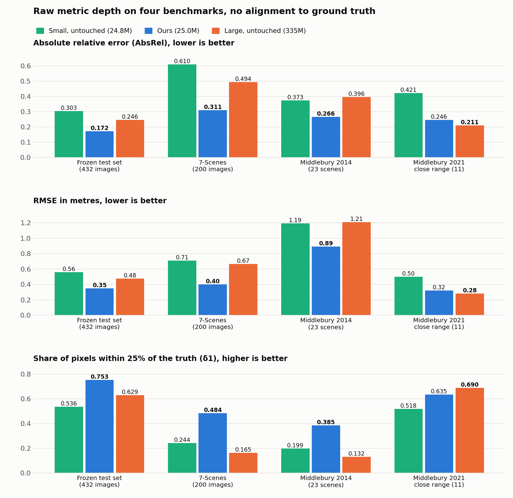
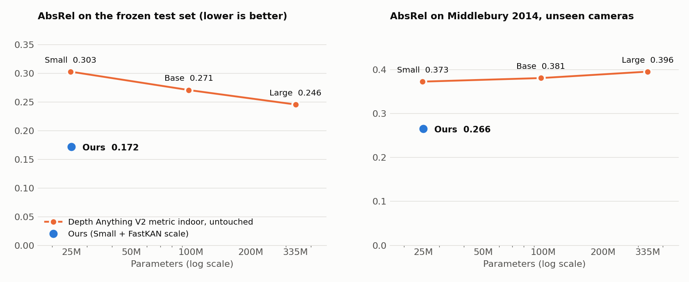
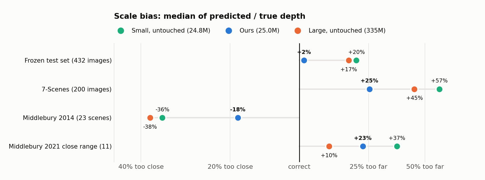
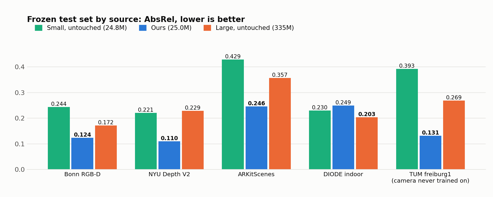
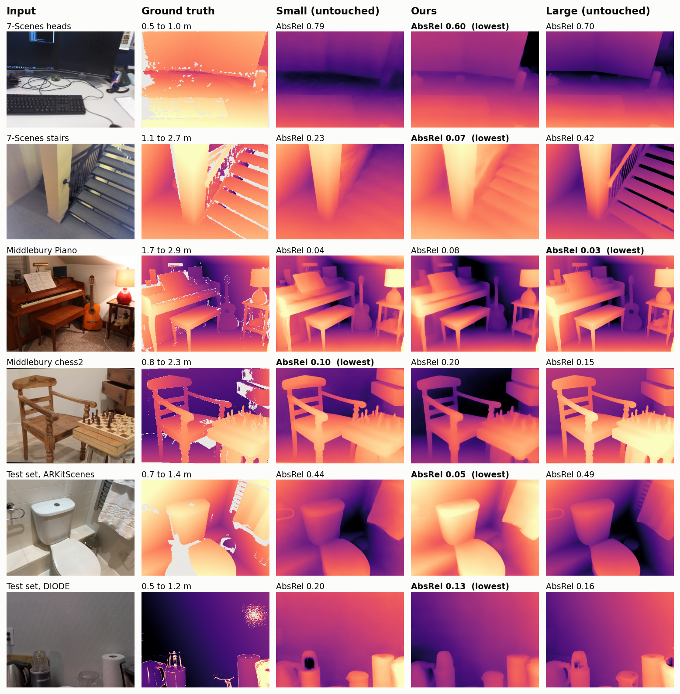
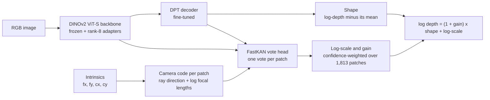
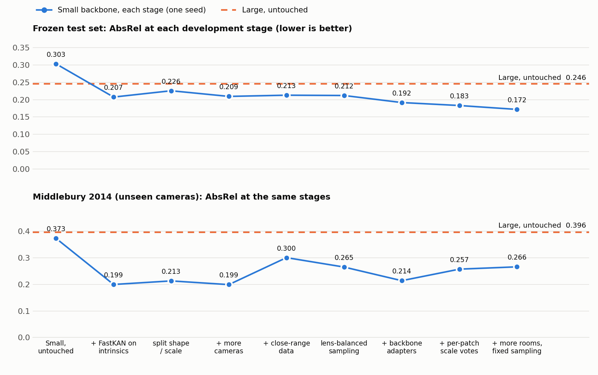

# kan-metric-depth

**Metric depth from one RGB image and its camera intrinsics, built on Depth Anything V2 metric indoor Small with a FastKAN scale branch.**

The goal: make the 25M-parameter Small model give better depth in metres than the 335M-parameter Large model, without distilling from Large and without any input beyond the image and its intrinsics.

Where it stands: on three of four benchmarks the model has lower metric error than Large with 13 times fewer parameters. Large is still ahead on close-range Middlebury scenes and on relative depth for unfamiliar scenes. Both sides are reported below.



## Contents

- [Results](#results)
- [Example predictions](#example-predictions)
- [How it works](#how-it-works)
- [What each step contributed](#what-each-step-contributed)
- [Strengths and limitations](#strengths-and-limitations)
- [Using the code](#using-the-code)
- [Repository layout](#repository-layout)
- [Acknowledgements](#acknowledgements)

## Results

All numbers are raw predictions in metres with **no alignment to ground truth**. Every model receives the same 252x336 input and runs at a 518x686 working size through the same code path. "Small" and "Large" are the official Depth Anything V2 metric indoor checkpoints, unchanged.

| Benchmark | Metric | Small, untouched | **Ours** | Large, untouched |
|---|---|---|---|---|
| | Parameters | 24.8M | **25.0M** | 335.3M |
| **Frozen test set** (432 images, 5 real cameras) | AbsRel ↓ | 0.303 | **0.172** | 0.246 |
| | RMSE (m) ↓ | 0.559 | **0.349** | 0.477 |
| | δ1 ↑ | 0.536 | **0.753** | 0.629 |
| **7-Scenes** (200 images, unseen dataset) | AbsRel ↓ | 0.610 | **0.311** | 0.494 |
| | RMSE (m) ↓ | 0.711 | **0.402** | 0.667 |
| | δ1 ↑ | 0.244 | **0.484** | 0.165 |
| **Middlebury 2014** (23 scenes, unseen DSLR lenses) | AbsRel ↓ | 0.373 | **0.266** | 0.396 |
| | RMSE (m) ↓ | 1.193 | **0.890** | 1.208 |
| | δ1 ↑ | 0.199 | **0.385** | 0.132 |
| **Middlebury 2021 close range** (11 scenes) | AbsRel ↓ | 0.421 | 0.246 | **0.211** |
| | RMSE (m) ↓ | 0.498 | 0.321 | **0.283** |
| | δ1 ↑ | 0.518 | 0.635 | **0.690** |

How to read the benchmarks:

- **Frozen test set.** Held-out scenes from Bonn RGB-D, NYU Depth V2, ARKitScenes and DIODE, plus TUM freiburg1, whose camera is never trained on. Our model is fine-tuned on other scenes of the first four datasets; Small and Large are not. This benchmark therefore shows what fine-tuning buys, not a like-for-like zero-shot comparison.
- **7-Scenes and Middlebury.** No model here trained on these datasets, so they are zero-shot for all three.
- **Metrics.** AbsRel is the mean of |predicted − true| / true. δ1 is the share of pixels whose predicted depth is within a factor 1.25 of the truth.

### Accuracy against model size



Going from Small to Large in the original family costs 310M parameters and lowers test AbsRel from 0.303 to 0.246. The FastKAN scale branch and backbone adapters add 0.24M parameters to Small and lower it to 0.172. On Middlebury 2014 the bigger original models do not help at all, because their error there is a scale error, not a detail error.

### Where the gain comes from: scale



The original checkpoints place rooms 17 to 57% too far and DSLR scenes about 37% too close. Reading the camera intrinsics removes most of that on the test set (+2%) and roughly halves it on unseen data. The remaining 18 to 25% scale error on unseen data is the main open problem.

### Relative depth (scale removed)

Each prediction is rescaled by its median before scoring, so this measures the shape of the depth map only.

| Benchmark | Metric | Small, untouched | **Ours** | Large, untouched |
|---|---|---|---|---|
| Frozen test set | δ1 ↑ | 0.885 | 0.929 | **0.940** |
| 7-Scenes | δ1 ↑ | 0.834 | 0.882 | **0.893** |
| Middlebury 2014 | δ1 ↑ | 0.849 | **0.929** | 0.891 |
| Middlebury 2021 close range | δ1 ↑ | 0.904 | 0.939 | **0.989** |

Relative depth improved over Small everywhere, but Large's bigger backbone still gives better shape on three of four benchmarks.

### Frozen test set by source



| Source | Small, untouched | **Ours** | Large, untouched |
|---|---|---|---|
| Bonn RGB-D | 0.244 | **0.124** | 0.172 |
| NYU Depth V2 | 0.221 | **0.110** | 0.229 |
| ARKitScenes | 0.429 | **0.246** | 0.357 |
| DIODE indoor | 0.230 | 0.249 | **0.203** |
| TUM freiburg1 (camera never trained on) | 0.393 | **0.131** | 0.269 |

## Example predictions



Each row uses one colour scale for the ground truth and all three predictions (bright = near, dark = far), so a prediction that is too far looks darker than the ground truth. Grey means no ground truth. The six images were fixed before looking at the predictions: the middle frame of each 7-Scenes sequence, two Middlebury scenes, and the first ARKitScenes and DIODE image of the test set. They include two rows where our model is not the best.

## How it works



1. **Shape and scale are separated.** The decoder's log-depth has its per-image mean removed and is trained with a loss that cannot see scale. A separate branch predicts the image's log-scale and is trained with a metric loss that cannot change the shape.
2. **The scale branch reads the camera.** Each patch gets a camera code: its viewing ray, (u − cx)/fx and (v − cy)/fy, plus the log focal lengths relative to image size. This is what lets one network handle different lenses.
3. **FastKAN makes the scale decision.** A shared FastKAN (Gaussian radial-basis KAN layers) reads each patch's backbone tokens, its local decoder depth and its camera code, and outputs logits over 12 log-scale hypotheses, a confidence and a gain. The confidence-weighted votes of all patches give the image's scale.
4. **Small trainable footprint.** The backbone is frozen except for rank-8 low-rank adapters on the attention query and value projections.

| Part | Parameters | Trained |
|---|---|---|
| DINOv2 ViT-S backbone | 22.06M | no |
| Low-rank adapters on the backbone | 0.15M | yes |
| DPT neck and head | 2.73M | yes |
| FastKAN vote head and camera shift | 0.09M | yes |
| **Total** | **25.03M** | 2.97M |

Training: 11,960 images from Bonn RGB-D, NYU Depth V2, ARKitScenes, DIODE, Hypersim, SUN RGB-D (Kinect v2, RealSense, Xtion) and BOP tabletop sets, with zoom and crop augmentation that rewrites the intrinsics to match, so a few real cameras cover a wide range of virtual lenses. No distillation from Large. The final model trained for 12 epochs of 5,000 samples on a 4 GB laptop GPU.

## What each step contributed



| Stage | Frozen test AbsRel | Middlebury 2014 AbsRel |
|---|---|---|
| Small, untouched | 0.303 | 0.373 |
| + FastKAN conditioning on intrinsics | 0.207 | 0.199 |
| Split shape / scale | 0.226 | 0.213 |
| + more cameras (SUN RGB-D) | 0.209 | 0.199 |
| + close-range tabletop data | 0.213 | 0.300 |
| Lens-balanced sampling | 0.212 | 0.265 |
| + backbone adapters | 0.192 | 0.214 |
| + per-patch scale votes | 0.183 | 0.257 |
| + more rooms, corrected sampling and loss weighting (final) | **0.172** | 0.266 |
| Large, untouched | 0.246 | 0.396 |

The first step, giving the model the intrinsics, is the largest single gain. Later steps keep improving the test set, while Middlebury 2014 moves up and down between 0.20 and 0.30: the choices that helped close-range scenes cost accuracy on DSLR scenes. Each stage is one training run.

Things that were tried and did not help are kept in the [experiment log](docs/EXPERIMENT_LOG.md): a per-image shift in metres, larger adapters, and ground-plane or known-object scale cues, which need information a single image does not contain.

## Strengths and limitations

**Strengths**

- **Lower metric error than Large on three of four benchmarks** with 25.0M parameters against 335.3M.
- **Scale is far better calibrated.** Median scale error on the test set drops from +17% (Large) to +2%.
- **Works across lenses.** One model covers phone, Kinect-class and DSLR focal lengths because it is told the intrinsics instead of guessing them.
- **Cheap to train.** 2.97M trainable parameters, a 4 GB laptop GPU, no teacher model.
- **Relative depth also improves** over the Small starting point on every benchmark.

**Limitations**

- **Large still wins on close-range scenes.** On Middlebury 2021 close range Large has lower error on every metric (AbsRel 0.211 against 0.246).
- **Large still has better relative depth** on three of four benchmarks. A bigger backbone gives sharper structure, and nothing here closes that gap.
- **Scale on unfamiliar scenes is not solved.** The model is still 18 to 25% off on 7-Scenes and Middlebury. On two handheld TUM RGB-D sequences that are not in the tables above (freiburg2 desk, freiburg3 long office) it places the scene 15 to 21% too close, and Large has the lower AbsRel there (0.192 against 0.221, and 0.168 against 0.205). Those scores are in [results/fresh_eval.json](results/fresh_eval.json).
- **The test-set comparison is not zero-shot for our model.** It is fine-tuned on other scenes of four of the five test datasets; Small and Large are not.
- **One seed for the final model.** An earlier three-seed check gave a spread of about ±0.005 AbsRel on the test set, but ±0.03 on the 11 close-range scenes, which is too small a set to rank models.
- **The unseen benchmarks guided design decisions**, so they are unseen by training but not untouched.
- **FastKAN is not shown to beat an MLP.** A size-matched MLP conditioner reached 0.213 ± 0.006 test AbsRel against FastKAN's 0.205 ± 0.002 over three seeds, a gap about the size of the seed spread.
- **Intrinsics are required** at inference.
- **Speed was not measured.**
- **Trained weights are not in this repository.**

## Using the code

### Install

```bash
python -m venv .venv
# install a CUDA build of PyTorch first: https://pytorch.org/get-started/locally/
pip install -r requirements.txt
```

### Predict

```python
import torch
from kan_metric_depth.model import SplitScaleDepth

model = SplitScaleDepth("kan", work_size=(518, 686), lora_rank=8, votes=12).cuda().eval()
model.load_state_dict(torch.load("runs/split9_kan_data/best.pt")["model"])

rgb = ...          # float tensor [B, 3, H, W] in 0..1
intrinsics = ...   # float tensor [B, 4] = (fx, fy, cx, cy) in pixels of that image
with torch.inference_mode():
    depth_m = model(rgb.cuda(), intrinsics.cuda()).exp()   # [B, 1, H, W], metres
```

### Train the final model

```bash
python train.py --arch split --cond kan --lora-rank 8 --votes 12 \
    --work-height 518 --work-width 686 --work-jitter \
    --batch-size 4 --epochs 12 --samples-per-epoch 5000 \
    --source-power 0.5 --per-image-loss \
    --zoom-min 0.5 --zoom-max 4.0 --focal-min 0.5 --focal-max 2.8 \
    --output runs/split9_kan_data
```

Validation picks the checkpoint. The frozen test set is scored only afterwards:

```bash
python train.py --arch split --cond kan --lora-rank 8 --votes 12 \
    --work-height 518 --work-width 686 --output runs/split9_kan_data --test
```

### Evaluate

```bash
python eval_test_set.py --model-id depth-anything/Depth-Anything-V2-Metric-Indoor-Large-hf --name large   # reference model
python eval_fresh.py          # 7-Scenes and TUM sequences
python eval_middlebury.py     # Middlebury 2014 and 2021
python -m tools.make_unseen_comparison   # results/UNSEEN_COMPARISON.md
python -m tools.make_figures             # README charts (needs matplotlib)
```

### Data

Datasets are not included. The loader in [kan_metric_depth/data.py](kan_metric_depth/data.py) expects them under `datasets/`:

| Folder | Dataset | Used for |
|---|---|---|
| `bonn_rgbd_dynamic` | Bonn RGB-D Dynamic | train, val, test |
| `nyu_v2_val` | NYU Depth V2 labelled test frames | train, val, test |
| `arkitscenes_sub` | ARKitScenes upsampling subset ([tools/collect_arkit.py](tools/collect_arkit.py)) | train, val, test |
| `diode_val` | DIODE indoor validation | train, val, test |
| `hypersim_sub` | Hypersim (9 scenes) | train, val |
| `sunrgbd` | SUN RGB-D without its Kinect v1 part | train, val |
| `bop` | BOP: YCB-Video, T-LESS, Linemod-Occluded, HOPE, HomebrewedDB, TUD-L | train, val |
| `tum_indoor` | TUM RGB-D freiburg1 | test only |
| `fresh_eval` | 7-Scenes heads and stairs, TUM freiburg2 desk, freiburg3 long office | evaluation only |
| `middlebury` | Middlebury stereo 2014 and 2021 | evaluation only |

Scenes are held out whole. The 440-image test list is frozen in [results/test_set_manifest.json](results/test_set_manifest.json), and the test set was never used for training, tuning or checkpoint selection.

## Repository layout

```
kan_metric_depth/     model (FastKAN, adapters, split shape/scale), data loader, metrics
train.py              training, and scoring a checkpoint on the frozen test set
eval_test_set.py      untouched Depth Anything V2 metric checkpoints on the frozen test set
eval_fresh.py         7-Scenes and TUM sequences
eval_middlebury.py    Middlebury 2014 and 2021
diagnostics/          oracle corrections, geometry cues, support-plane statistics, frozen-feature scale fit
tools/                data collection, test-set freezing, comparison table, figures
results/              raw scores of every run (JSON) and the comparison table
docs/                 figures and the full experiment log
```

## Acknowledgements

Built on [Depth Anything V2](https://github.com/DepthAnything/Depth-Anything-V2) (Yang et al., 2024) through its Hugging Face `transformers` checkpoints. The KAN layers follow [FastKAN](https://github.com/ZiyaoLi/fast-kan) (Li, 2024): Gaussian radial basis functions in place of B-splines. The evaluation data comes from 7-Scenes, Middlebury stereo, TUM RGB-D, Bonn RGB-D Dynamic, NYU Depth V2, ARKitScenes and DIODE; each dataset keeps its own licence and none of it is redistributed here apart from the six example frames in the figure above.
